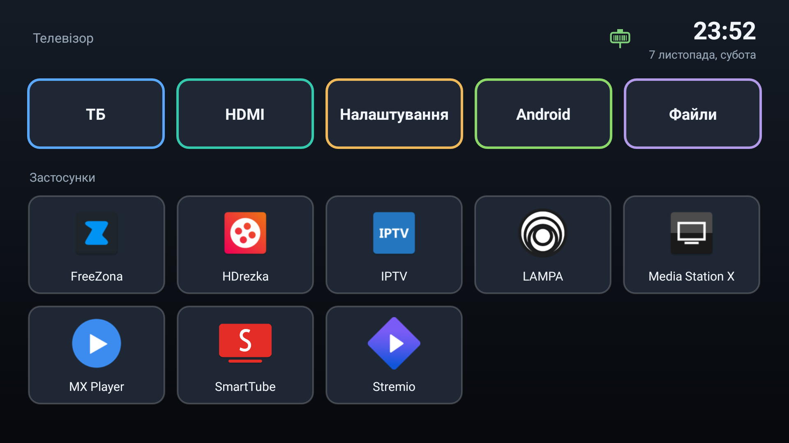

# KiviLite — a minimal Android TV launcher

[Русский](README.md) · [English](README.en.md) · [Українська](README.uk.md)

A lightweight replacement for the vendor shell on cheap Android TV boxes and TVs
(MStar / Kivi / Funshion, Android 5–7). Built and verified on an **LG 43UK32G**
(MStar, Android 6.0.1, API 23, 1920×1080, density 320).

The point: a launcher that **wastes neither RAM nor CPU**. No libraries, no XML
layouts, not a single bitmap — every icon and every background is drawn in code
on a `Canvas`.

| Metric | Value |
|---|---|
| APK size | **49,621 B** (~49 KB) |
| Source | **2,584** lines of Java, 0 XML layouts |
| External dependencies | **none** (only `android.jar`) |
| Memory on the TV | **PSS ≈ 11.8 MB**, RSS ≈ 42 MB |
| Idle CPU | **≈ 0%** (never shows up in `dumpsys cpuinfo`) |
| Vendor `com.kivi.launcher_v2` for comparison | ≈ 90 MB RSS |
| Free RAM after the swap | ≈ 253 MB (was ≈ 45 MB) |
| minSdk / targetSdk | 21 / 23 |
| License | MIT |



## Features

**Home screen**
- Header: screen title, network indicator, weather, currency rates, clock and date.
- Background drawn in code (smooth "water" gradients) and cached at ¼ resolution —
  the screen blits a ready bitmap instead of recomputing gradients every frame.
- Six shortcut tiles: **TV, HDMI, Settings, Android, Picture, Files**
  (package/activity of each lives in the `TILES` array).
- Focus highlight is "glass": blue fill, white rim, white label (label colour comes
  from a `ColorStateList`, otherwise it is unreadable on the highlight).

**App grid**
- 5 columns, alphabetical order, two-line labels.
- Hide and restore apps via `SharedPreferences` (`minihome/hidden`), a
  "Hidden: N" chip and a dedicated hidden-apps menu.
- Uninstall goes through the system dialog (`ACTION_DELETE`) — nothing is removed silently.
- **Edit mode** — the button next to the section title: cards get a coloured frame and
  OK opens the app menu instead of launching; exit with "Done", BACK or MENU.
- Holding OK on a card (≈650 ms) opens the same menu.

**Network state**
- Three code-drawn icons: **RJ45** (wired), Wi-Fi arcs, crossed circle (offline).
  Refreshed once a minute.

**Weather and rates**
- Weather: condition icon + temperature, refreshed at most hourly; keeps the last
  known value when the network is down.
- Rates: USD/UAH, EUR/UAH, BTC/USD, ETH/USD — every 3.5 hours, rounded to cents.
  Currency icons are drawn in code as well (a stroked "B", a diamond for Ethereum).

**Localisation**
- Russian, Ukrainian and English, chosen from the system locale.

**SOURCE key and picture panel**
- The remote's SOURCE key reaches Android as keycode 255 ("unknown key"), so the
  launcher's own accessibility service (`SourceKeyService`) intercepts it and opens
  `PicturePanelActivity` over any screen.
- The panel controls backlight, brightness, contrast, saturation, sharpness and hue
  through the vendor API `com.mstar.android.tvapi.common.PictureManager` via reflection;
  backlight is genuinely read and written.

## Install

```bash
# 1. Build it (see "Build") or grab the APK from Releases
# 2. Push it to the TV
adb connect 192.168.1.214:5555
adb install -r MiniHome.apk
adb shell am start -n com.minihome.tv/.MainActivity
```

Details, checks and rollback: [docs/INSTALL.md](docs/INSTALL.md).
Internals, metrics and pitfalls: [docs/FEATURES.md](docs/FEATURES.md).

## Making it the default launcher (and binding the remote's HOME key)

The order below is verified on this firmware. Setting `home_activity` alone is
**not enough** — the value is stored, but the HOME key keeps opening the old launcher.

```bash
A=192.168.1.214:5555

# 1. Make sure the launcher renders
adb -s $A shell am start -n com.minihome.tv/.MainActivity

# 2. Disable the vendor launcher — disable, do not uninstall
adb -s $A shell "su root pm disable --user 0 com.kivi.launcher_v2"
adb -s $A shell "su root pm disable --user 0 com.wezom.kivilauncher"   # if present

# 3. Point the home activity at KiviLite
adb -s $A shell "settings put global home_activity com.minihome.tv/.MainActivity"

# 4. Reboot
adb -s $A shell "su root reboot"
```

Verify after boot:

```bash
adb -s $A shell "dumpsys activity activities | grep -i category.HOME"   # should be KiviLite
adb -s $A shell "input keyevent 3"                                      # HOME opens KiviLite
```

One-command rollback (the launcher stays installed):

```bash
adb -s $A shell "su root pm enable --user 0 com.kivi.launcher_v2"   # + reboot
```

Three things that will bite you:

1. **No other enabled package may declare a HOME activity**, or it wins the HOME
   resolution (keep `tv.fun.guide` disabled).
2. **The boot animation never goes away** until `service.launcher.visible=1` is set:
   the ROM waits for that flag from *its* launcher, and a third-party one never sets it.
   Fix: `adb shell "su root setprop service.launcher.visible 1"` (or in a boot script).
3. Disable the vendor launcher instead of uninstalling it — rollback is one command.

## Remote control

| Key | Action |
|---|---|
| D-pad | Move between tiles and app cards |
| OK | Launch app / enter a mode |
| OK (hold ≈650 ms) | App menu: uninstall, hide, restore |
| MENU | Toggle edit mode |
| BACK | Leave edit mode |
| SOURCE | Picture panel over any screen |

## Build

You need JDK 8+ and the Android SDK (build-tools with `aapt2`, `d8`, `zipalign`,
`apksigner`). No Gradle — a single script does the job:

```powershell
# Edit the JDK / Android SDK / keystore paths at the top of build.ps1
powershell -ExecutionPolicy Bypass -File build.ps1
# → MiniHome.apk
```

Bring your own signing key:

```bash
keytool -genkeypair -keystore my.keystore -alias lite -keyalg RSA -keysize 2048 \
        -validity 10000 -storepass <pass> -keypass <pass> -dname "CN=KiviLite"
```

## Project layout

```
AndroidManifest.xml                     HOME activity, SOURCE service, permissions
build.ps1                               build: aapt2 → javac → d8 → zipalign → apksigner
res/values/strings.xml                  app name and service description
res/xml/source_keys.xml                 accessibility service config (key filtering)
src/com/minihome/tv/MainActivity.java   home screen: header, tiles, grid, edit mode
src/com/minihome/tv/PicturePanelActivity.java  picture panel (vendor API via reflection)
src/com/minihome/tv/SourceKeyService.java      SOURCE key interception
src/com/minihome/tv/ApiProbeActivity.java      one-shot vendor API probe into /sdcard
docs/INSTALL.md                         install, HOME binding, rollback
docs/FEATURES.md                        features, metrics and pitfalls in depth
```

## Pitfalls found along the way (verified on hardware)

- **`GridView` never delivers a long press to the child card** — the card's
  `OnLongClickListener` is not called. The working combo is
  `GridView.setOnItemLongClickListener` plus a 650 ms timer in the card's `OnKeyListener`.
- **"Highlight is sometimes translucent, sometimes blue"** — `GridView` marks the item
  as `selected`, while the `StateListDrawable`/`ColorStateList` only handled `focused`.
- **Focusable children break `OnItemClickListener`** — attach the click listener to the
  item itself inside `getView()`.
- **`adb pull` needs a native path** (`C:/...`); a POSIX path like `/c/...` is rejected.
- Inspecting the UI without eyes: `uiautomator dump` (texts and bounds), `screencap`
  and pixel analysis of the frame (highlight colour, drawn icons).

## License

MIT — see [LICENSE](LICENSE).

Not affiliated with LG, Kivi, Funshion or MStar; those names appear only to describe
compatibility. All trademarks belong to their owners.
