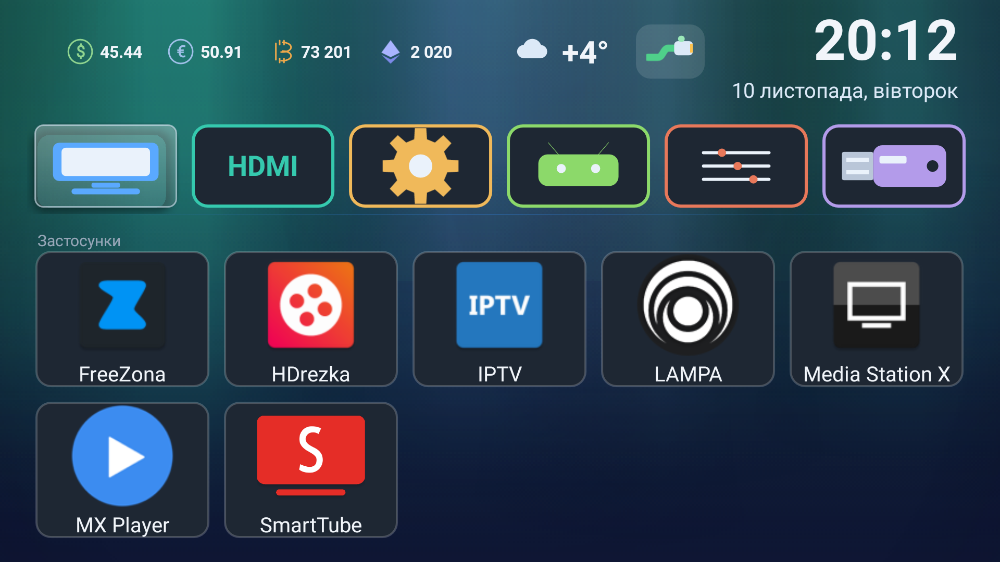
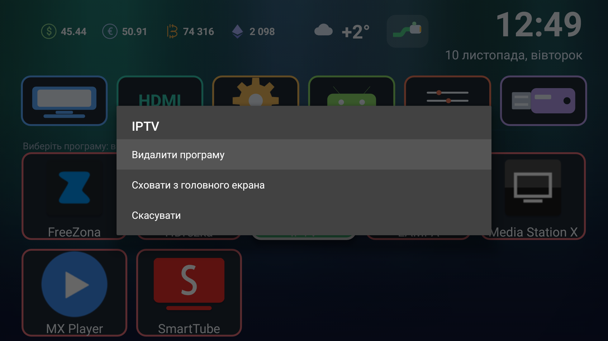
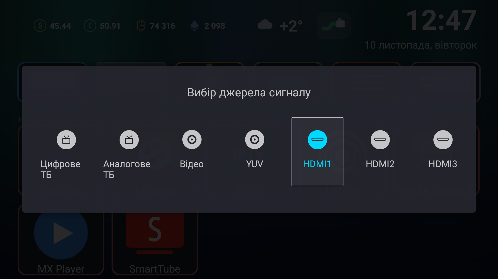

# KiviLite — минималистичный лаунчер для Android TV

[Русский](README.md) · [English](README.en.md) · [Українська](README.uk.md)

Лёгкая замена вендорской оболочки на китайских Android-ТВ и ТВ-приставках
(MStar / Kivi / Funshion, Android 5–7). Собран и проверен на **LG 43UK32G**
(MStar, Android 6.0.1, API 23, 1920×1080, density 320).

**Версия 1.2.** Дальше проект не развивается: всё, что нужно такому ТВ, уже сделано
и проверено на железе. Изменения 1.2 — в конце файла.

Главная идея: лаунчер, который **не занимает память и не греет процессор**.
Никаких библиотек, никакой разметки, ни одной картинки — вся графика и все иконки
рисуются кодом на Canvas.

| Метрика | Значение |
|---|---|
| Размер APK | **41 429 Б** (ужатый релиз) |
| Размер dex | **62 092 Б** после R8 |
| Исходный код | **2 787** строк Java, 0 XML-разметок |
| Внешние зависимости | **нет** (только `android.jar`) |
| Память на телевизоре | **PSS ≈ 6,3 МБ** (кэш фона в ¼ разрешения) |
| CPU в простое | **≈ 0%** (в `dumpsys cpuinfo` не появляется) |
| Вендорский `com.kivi.launcher_v2` для сравнения | ≈ 90 МБ RSS |
| Свободная память после подмены лаунчера | ≈ 253 МБ (было ≈ 45 МБ) |
| minSdk / targetSdk | 21 / 23 |
| Лицензия | MIT |

## Скриншоты

**Главный экран** — погода, курсы (USD/UAH, EUR/UAH, BTC/USD, ETH/USD), часы и дата,
плитки быстрого доступа и сетка приложений:



**Меню приложения** — удалить, скрыть или вернуть на экран (ничего не удаляется молча):



**Панель источников сигнала** — открывается плиткой ТВ/HDMI:




## Возможности

**Главный экран**
- Шапка: название экрана, значок сети, погода, курсы валют, часы и дата.
- Фон рисуется кодом (северное сияние, занавеси мягко растворяются книзу) и кэшируется в ¼ разрешения —
  на экран попадает готовая битмапа, а не пересчёт градиентов каждый кадр.
- 6 плиток быстрого доступа: **ТВ, HDMI, Настройки, Android, Картинка, Файлы**
  (пакет и активность каждой — в массиве `TILES`).
- Подсветка фокуса — «стекло»: голубая заливка, белая кромка, белая подпись
  (цвет текста через `ColorStateList`, иначе на заливке текст не читается).

**Сетка приложений**
- 5 колонок, сортировка по алфавиту, подпись в две строки.
- Скрытие и возврат приложений: `SharedPreferences` (`minihome/hidden`), чип
  «Скрытые: N» и отдельное меню скрытых.
- Удаление — через системный диалог (`ACTION_DELETE`), ничего не удаляется молча.
- Режим **«Изменить»** — кнопка рядом с заголовком: карточки получают рамку,
  ОК открывает меню приложения вместо запуска; выход — «Готово», BACK или MENU.
- Долгое удержание ОК на карточке (≈650 мс) открывает то же меню.

**Состояние сети**
- Три значка, нарисованных кодом: **RJ45** (провод), дуги Wi-Fi, перечёркнутый
  круг (нет сети). Обновление раз в минуту.

**Погода и курсы**
- Погода: значок по коду явления + температура. Обновляется не чаще раза в час,
  без сети остаётся последнее значение.
- Курсы: USD/UAH, EUR/UAH, BTC/USD, ETH/USD — раз в 3,5 часа, округление до копеек.
  Иконки валют тоже рисуются кодом (буква «B» со штрихами, ромб для Ethereum).

**Локализация**
- Русский, украинский, английский — по системной локали (`Locale.getDefault()`).

**Кнопка SOURCE и панель изображения**
- Кнопка SOURCE приходит в Android как код 255 («неизвестная клавиша»), поэтому
  её перехватывает собственная служба доступности `SourceKeyService` и открывает
  `PicturePanelActivity` поверх любого экрана.
- Панель: подсветка, яркость, контрастность, насыщенность, резкость, оттенок.
  Значения применяются вендорским API `com.mstar.android.tvapi.common.PictureManager`
  через отражение; подсветка читается и пишется по-настоящему.

## Установка

```bash
# 1. Собрать (см. «Сборка») или взять готовый APK из Releases
# 2. Поставить на телевизор
adb connect 192.168.1.214:5555
adb install -r MiniHome.apk
adb shell am start -n com.minihome.tv/.MainActivity
```

Если у ТВ уже включена отладка по сети, больше ничего не нужно — лаунчер запустится
и будет ждать, пока его назначат основным.

Подробно, с проверками и откатом — [docs/INSTALL.md](docs/INSTALL.md).
Описание внутренностей и метрик — [docs/FEATURES.md](docs/FEATURES.md).

## Как лаунчер стал основным и как привязана кнопка HOME пульта

Проверенный на этой прошивке порядок (одной только настройки `home_activity`
**недостаточно** — она сохраняется, но кнопка HOME продолжает открывать старый лаунчер):

```bash
A=192.168.1.214:5555

# 1. Убедиться, что лаунчер рисуется
adb -s $A shell am start -n com.minihome.tv/.MainActivity

# 2. Отключить вендорский лаунчер — именно отключить, не удалять
adb -s $A shell "su root pm disable --user 0 com.kivi.launcher_v2"
adb -s $A shell "su root pm disable --user 0 com.wezom.kivilauncher"   # если есть

# 3. Прописать домашнюю активность
adb -s $A shell "settings put global home_activity com.minihome.tv/.MainActivity"

# 4. Перезагрузка
adb -s $A shell "su root reboot"
```

Проверка после загрузки:

```bash
adb -s $A shell "dumpsys activity activities | grep -i category.HOME"   # должен быть KiviLite
adb -s $A shell "input keyevent 3"                                      # HOME открывает KiviLite
```

Откат в одну команду (лаунчер остаётся установленным):

```bash
adb -s $A shell "su root pm enable --user 0 com.kivi.launcher_v2"   # + reboot
```

Три момента, без которых не заработает:

1. **Ни один другой включённый пакет не должен объявлять HOME-активность** —
   иначе разрешение HOME уйдёт ему (`tv.fun.guide` держать отключённым).
2. **Заставка загрузки не гаснет**, пока не выставлен флаг `service.launcher.visible=1`:
   ром ждёт его от «своего» лаунчера, а сторонний его не ставит. Лечится одной строкой
   в автозапуске или вручную: `adb shell "su root setprop service.launcher.visible 1"`.
3. Отключение, а не удаление вендорского лаунчера — так откат занимает одну команду.

## Управление с пульта

| Кнопка | Действие |
|---|---|
| Стрелки | Перемещение по плиткам и сетке приложений |
| OK | Запуск приложения / вход в режим |
| OK (удержание ≈650 мс) | Меню приложения: удалить, скрыть, вернуть |
| MENU | Включить/выключить режим «Изменить» |
| BACK | Выйти из режима «Изменить» |
| SOURCE | Панель изображения поверх любого экрана |

## Сборка

Требуется JDK 8+ и Android SDK (build-tools с `aapt2`, `d8`, `zipalign`, `apksigner`).
Сборка без Gradle:

```powershell
# Отладочная сборка (d8, без ужатия): build.ps1
powershell -ExecutionPolicy Bypass -File build.ps1        # -> MiniHome.apk

# Ужатый релиз (R8: переименование, вырезание неиспользуемого, deflate 9):
bash build-release.sh                                     # -> MiniHome-release.apk
```

Правила ужатия — `r8-rules.pro` (точки входа из манифеста сохраняются, вендорский API
не требует правил: он вызывается по строкам). Релизная сборка дополнительно **не включает**
служебный `ApiProbeActivity` и его запись в манифесте.

Свой ключ подписи:

```bash
keytool -genkeypair -keystore my.keystore -alias lite -keyalg RSA -keysize 2048 \
        -validity 10000 -storepass <пароль> -keypass <пароль> -dname "CN=KiviLite"
```

## Структура проекта

```
AndroidManifest.xml                     HOME-активность, служба SOURCE, права
build.ps1                               отладочная сборка: aapt2 → javac → d8 → zipalign → apksigner
build-release.sh                        ужатый релиз: то же, но вместо d8 — R8 + deflate 9
r8-rules.pro                            правила ужатия (что нельзя вырезать и переименовывать)
res/values/strings.xml                  название приложения и описание службы
res/xml/source_keys.xml                 конфиг службы доступности (перехват клавиш)
src/com/minihome/tv/MainActivity.java   главный экран: шапка, плитки, сетка, режим изменения
src/com/minihome/tv/PicturePanelActivity.java  панель изображения (вендорский API через отражение)
src/com/minihome/tv/SourceKeyService.java      перехват кнопки SOURCE
src/com/minihome/tv/ApiProbeActivity.java      разовый зонд вендорского API в /sdcard
docs/INSTALL.md                         установка, привязка HOME, откат
docs/FEATURES.md                        подробно про фичи, метрики и грабли
```

## Грабли, найденные по ходу (проверено на железе)

- **`GridView` не отдаёт долгое нажатие дочерней карточке** — `OnLongClickListener`
  карточки не вызывается. Работает связка `GridView.setOnItemLongClickListener` +
  свой таймер 650 мс по `OnKeyListener` карточки.
- **Подсветка «то полупрозрачная, то голубая»** — `GridView` помечает элемент
  состоянием `selected`, а в `StateListDrawable`/`ColorStateList` был только `focused`.
- **Focusable-дети ломают `OnItemClickListener`** — клик приходится вешать на сам
  элемент в `getView()`.
- **`adb pull` требует нативный путь** (`C:/...`), POSIX-путь `/c/...` не принимается.
- Проверка UI без «глаз»: `uiautomator dump` (тексты и bounds), `screencap` и разбор
  пикселей кадра (цвет подсветки, нарисованные иконки).

## Лицензия

MIT — см. [LICENSE](LICENSE).

Проект не связан с LG, Kivi, Funshion и MStar: названия упомянуты только для
описания совместимости. Все товарные знаки принадлежат их владельцам.

## Что нового в версии 1.2

- **Часы крупнее** — 54 вместо 30, и при этом список приложений не сдвинулся вниз:
  отступы у шапки и над плитками поджаты.
- **Плитки первого ряда перерисованы** — сплошные яркие фигуры вместо тонких контуров,
  у каждой свой цвет; плитка «Файлы» — флешка с металлическим разъёмом.
- **Выделение — «стекло»** и у приложений, и у плиток: полупрозрачная заливка
  с бликом сверху и светлая кромка.
- **Значки приложений крупнее** — 104 точки, размер плитки при этом прежний.
- **Надписи в плитках приложений** — 20 вместо 15.
- **Значки валют крупнее** — 26 вместо 18.
- **Погода переехала к часам**, название города убрано, значок погоды цветной и вдвое
  крупнее: солнце, облако, дождь, снег, гроза — каждый своим цветом.
- **Фон — северное сияние**: занавеси мягко растворяются книзу, чёрного нет,
  кэш рисуется в ¼ разрешения.
- **Страховка фокуса**: если выделение терялось (после выхода из приложения или
  перестройки списка), оно возвращалось само.
- **Плитка «ТВ»** принудительно включает цифровое ТВ через родной API телевизора.
- **Кнопка «Змінити» убрана** — то же самое делает долгое нажатие на карточке.
