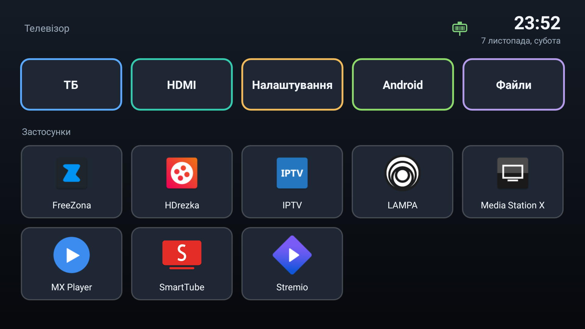

# KiviLite — мінімалістичний лаунчер для Android TV

[Русский](README.md) · [English](README.en.md) · [Українська](README.uk.md)

Легка заміна вендорської оболонки на китайських Android-ТВ і ТВ-приставках
(MStar / Kivi / Funshion, Android 5–7). Зібраний і перевірений на **LG 43UK32G**
(MStar, Android 6.0.1, API 23, 1920×1080, density 320).

Головна ідея: лаунчер, який **не займає пам'ять і не гріє процесор**.
Жодних бібліотек, жодної розмітки, жодної картинки — вся графіка та всі іконки
малюються кодом на Canvas.

| Метрика | Значення |
|---|---|
| Розмір APK | **49 621 Б** (~49 КБ) |
| Вихідний код | **2 584** рядки Java, 0 XML-розміток |
| Зовнішні залежності | **немає** (тільки `android.jar`) |
| Пам'ять на телевізорі | **PSS ≈ 11,8 МБ**, RSS ≈ 42 МБ |
| CPU у простої | **≈ 0%** (у `dumpsys cpuinfo` не з'являється) |
| Вендорський `com.kivi.launcher_v2` для порівняння | ≈ 90 МБ RSS |
| Вільна пам'ять після заміни лаунчера | ≈ 253 МБ (було ≈ 45 МБ) |
| minSdk / targetSdk | 21 / 23 |
| Ліцензія | MIT |



## Можливості

**Головний екран**
- Шапка: назва екрана, значок мережі, погода, курси валют, годинник і дата.
- Фон малюється кодом (плавні «водяні» градієнти) і кешується в ¼ роздільності —
  на екран потрапляє готова бітмапа, а не перерахунок градієнтів кожен кадр.
- 6 плиток швидкого доступу: **ТБ, HDMI, Налаштування, Android, Зображення, Файли**
  (пакет і активність кожної — у масиві `TILES`).
- Підсвітка фокуса — «скло»: блакитна заливка, біла кромка, білий підпис
  (колір тексту через `ColorStateList`, інакше на заливці текст не читається).

**Сітка застосунків**
- 5 колонок, сортування за абеткою, підпис у два рядки.
- Приховування та повернення застосунків: `SharedPreferences` (`minihome/hidden`), чип
  «Приховані: N» і окреме меню прихованих.
- Видалення — через системний діалог (`ACTION_DELETE`), нічого не видаляється мовчки.
- Режим **«Змінити»** — кнопка поруч із заголовком: картки отримують рамку,
  OK відкриває меню застосунку замість запуску; вихід — «Готово», BACK або MENU.
- Довге утримання OK на картці (≈650 мс) відкриває те саме меню.

**Стан мережі**
- Три значки, намальовані кодом: **RJ45** (дріт), дуги Wi-Fi, перекреслене
  коло (немає мережі). Оновлення раз на хвилину.

**Погода та курси**
- Погода: значок за кодом явища + температура. Оновлюється не частіше разу на годину,
  без мережі залишається останнє значення.
- Курси: USD/UAH, EUR/UAH, BTC/USD, ETH/USD — раз на 3,5 години, округлення до копійок.
  Іконки валют теж малюються кодом (літера «B» зі штрихами, ромб для Ethereum).

**Локалізація**
- Російська, українська, англійська — за системною локаллю (`Locale.getDefault()`).

**Кнопка SOURCE і панель зображення**
- Кнопка SOURCE приходить в Android як код 255 («невідома клавіша»), тому
  її перехоплює власна служба доступності `SourceKeyService` і відкриває
  `PicturePanelActivity` поверх будь-якого екрана.
- Панель: підсвітка, яскравість, контрастність, насиченість, різкість, відтінок.
  Значення застосовуються вендорським API `com.mstar.android.tvapi.common.PictureManager`
  через рефлексію; підсвітка читається і пишеться по-справжньому.

## Встановлення

```bash
# 1. Зібрати (див. «Збирання») або взяти готовий APK з Releases
# 2. Поставити на телевізор
adb connect 192.168.1.214:5555
adb install -r MiniHome.apk
adb shell am start -n com.minihome.tv/.MainActivity
```

Якщо на ТВ уже ввімкнено налагодження по мережі, більше нічого не потрібно — лаунчер
запуститься і чекатиме, поки його призначать основним.

Докладно, з перевірками та відкатом — [docs/INSTALL.md](docs/INSTALL.md).
Опис внутрішнього устрою та метрик — [docs/FEATURES.md](docs/FEATURES.md).

## Як лаунчер став основним і як прив'язана кнопка HOME пульта

Перевірений на цій прошивці порядок (самої лише настанови `home_activity`
**недостатньо** — вона зберігається, але кнопка HOME продовжує відкривати старий лаунчер):

```bash
A=192.168.1.214:5555

# 1. Переконатися, що лаунчер малюється
adb -s $A shell am start -n com.minihome.tv/.MainActivity

# 2. Вимкнути вендорський лаунчер — саме вимкнути, не видаляти
adb -s $A shell "su root pm disable --user 0 com.kivi.launcher_v2"
adb -s $A shell "su root pm disable --user 0 com.wezom.kivilauncher"   # якщо є

# 3. Прописати домашню активність
adb -s $A shell "settings put global home_activity com.minihome.tv/.MainActivity"

# 4. Перезавантаження
adb -s $A shell "su root reboot"
```

Перевірка після завантаження:

```bash
adb -s $A shell "dumpsys activity activities | grep -i category.HOME"   # має бути KiviLite
adb -s $A shell "input keyevent 3"                                      # HOME відкриває KiviLite
```

Відкат однією командою (лаунчер залишається встановленим):

```bash
adb -s $A shell "su root pm enable --user 0 com.kivi.launcher_v2"   # + reboot
```

Три моменти, без яких не працює:

1. **Жоден інший увімкнений пакет не повинен оголошувати HOME-активність** —
   інакше дозвіл HOME піде йому (`tv.fun.guide` тримати вимкненим).
2. **Заставка завантаження не гасне**, поки не виставлено прапорець `service.launcher.visible=1`:
   ром чекає його від «свого» лаунчера, а сторонній його не ставить. Лікується одним рядком
   в автозапуску або вручну: `adb shell "su root setprop service.launcher.visible 1"`.
3. Вимкнення, а не видалення вендорського лаунчера — так відкат займає одну команду.

## Керування з пульта

| Кнопка | Дія |
|---|---|
| Стрілки | Переміщення плитками та сіткою застосунків |
| OK | Запуск застосунку / вхід у режим |
| OK (утримання ≈650 мс) | Меню застосунку: видалити, приховати, повернути |
| MENU | Увімкнути/вимкнути режим «Змінити» |
| BACK | Вийти з режиму «Змінити» |
| SOURCE | Панель зображення поверх будь-якого екрана |

## Збирання

Потрібні JDK 8+ та Android SDK (build-tools з `aapt2`, `d8`, `zipalign`, `apksigner`).
Збирання без Gradle — одним скриптом:

```powershell
# Шляхи до JDK, Android SDK і ключа правляться на початку build.ps1
powershell -ExecutionPolicy Bypass -File build.ps1
# → MiniHome.apk
```

Власний ключ підпису:

```bash
keytool -genkeypair -keystore my.keystore -alias lite -keyalg RSA -keysize 2048 \
        -validity 10000 -storepass <пароль> -keypass <пароль> -dname "CN=KiviLite"
```

## Структура проєкту

```
AndroidManifest.xml                     HOME-активність, служба SOURCE, дозволи
build.ps1                               збирання: aapt2 → javac → d8 → zipalign → apksigner
res/values/strings.xml                  назва застосунку та опис служби
res/xml/source_keys.xml                 конфіг служби доступності (перехоплення клавіш)
src/com/minihome/tv/MainActivity.java   головний екран: шапка, плитки, сітка, режим зміни
src/com/minihome/tv/PicturePanelActivity.java  панель зображення (вендорський API через рефлексію)
src/com/minihome/tv/SourceKeyService.java      перехоплення кнопки SOURCE
src/com/minihome/tv/ApiProbeActivity.java      разовий зонд вендорського API у /sdcard
docs/INSTALL.md                         встановлення, прив'язка HOME, відкат
docs/FEATURES.md                        докладно про фічі, метрики та підводні камені
```

## Підводні камені, знайдені по ходу (перевірено на залізі)

- **`GridView` не віддає довге натискання дочірній картці** — `OnLongClickListener`
  картки не викликається. Працює зв'язка `GridView.setOnItemLongClickListener` +
  власний таймер 650 мс по `OnKeyListener` картки.
- **Підсвітка «то напівпрозора, то блакитна»** — `GridView` позначає елемент
  станом `selected`, а в `StateListDrawable`/`ColorStateList` був лише `focused`.
- **Focusable-діти ламають `OnItemClickListener`** — клік доводиться вішати на сам
  елемент у `getView()`.
- **`adb pull` вимагає нативного шляху** (`C:/...`), POSIX-шлях `/c/...` не приймається.
- Перевірка UI без «очей»: `uiautomator dump` (тексти та bounds), `screencap` і розбір
  пікселів кадру (колір підсвітки, намальовані іконки).

## Ліцензія

MIT — див. [LICENSE](LICENSE).

Проєкт не пов'язаний з LG, Kivi, Funshion і MStar: назви згадані лише для
опису сумісності. Усі торгові марки належать їхнім власникам.
